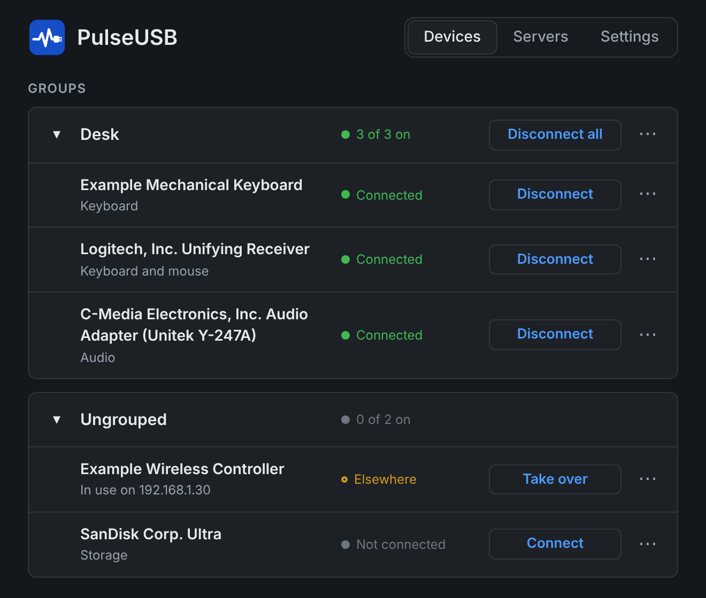

<div align="center">

# PulseUSB

**Use USB devices plugged into another computer, over your network, as if they were plugged in locally.**

[](https://github.com/steppapig/PulseUSB/actions/workflows/build.yml)
[](https://github.com/steppapig/PulseUSB/releases/latest)
[](LICENSE)

[Download](https://github.com/steppapig/PulseUSB/releases/latest) ·
[Quick start](#quick-start) ·
[Troubleshooting](docs/troubleshooting.md) ·
[Reference](docs/reference.md)

<picture>
  <source media="(prefers-color-scheme: light)" srcset="docs/screenshot-light.png">
  
</picture>

</div>

## Overview

PulseUSB shares USB devices from a small Linux server to Windows and Linux
computers on the same network. It is an open-source, lossless USB-over-IP
solution built on the standard USB/IP protocol, with a desktop app that
makes it practical for everyday use.

**Typical uses**

- Keep a headless machine (a Raspberry Pi, mini PC or old laptop) next to
  your peripherals, and the computer that uses them somewhere else.
- Move a keyboard, mouse and headset between computers, KVM-style.
- Reach dongles, licence keys, printers and lab equipment from any desk.
- Run game controllers, wheels, flight sticks and sim rigs from a PC in
  another room.

## Features

| | |
|---|---|
| **Lossless** | Every USB request is forwarded unchanged: no compression, re-encoding or dropped data. |
| **Any device class** | Keyboards and mice, game controllers, audio interfaces and microphones, storage, and more. |
| **Zero configuration** | Servers are discovered on the local network automatically. |
| **Follows the device** | Names, groups and auto-connect are tied to the device, not the USB port it is in. |
| **Groups** | Connect and disconnect sets of devices together, from the app, the tray or a keyboard shortcut. |
| **Multi-computer** | See which computer is using a device and take it over with one click. |
| **KVM-style escape** | **Ctrl+Alt+Shift+F12** on a shared keyboard returns everything to the server machine. |
| **Native apps** | Tray app for Windows, windowed app for Linux, light and dark themes. |
| **Starts with the system** | Optionally before sign-in on Windows, so devices are ready at the login screen. |

## Platforms

| Component | Runs on |
|---|---|
| Server | 64-bit Linux with systemd (x86-64 or ARM64) |
| App | Windows 10 (1903+) and 11, x86-64 · Linux (x86-64 or ARM64) |

## Quick start

Download the files from the
[latest release](https://github.com/steppapig/PulseUSB/releases/latest).

**1. Install the server** on the Linux machine the devices are plugged into:

```bash
chmod +x pulseusb-server-linux-amd64
sudo ./pulseusb-server-linux-amd64 install
```

Use the `arm64` file on a Raspberry Pi or other ARM board. The installer
asks for a server name and which devices to share, and sets up the service
and firewall.

**2. Install the app** on the computer that will use the devices:

- **Windows:** run `PulseUSB-Setup.exe`. It also installs the
  [usbip-win2](https://github.com/vadimgrn/usbip-win2) driver.
- **Linux:** run `sudo ./pulseusb-linux-amd64 install`.

**3. Connect.** Open PulseUSB, pick a device and press **Connect**. Tick
**Auto-connect** in its **⋯** menu to have it connect every time.

## Security

USB/IP has no authentication or encryption. Use PulseUSB on a network you
trust, and restrict a server to specific computers with `-allow` (see the
[reference](docs/reference.md#server-options)), a firewall or a VPN.

## Documentation

- [Troubleshooting](docs/troubleshooting.md): discovery, device-specific
  fixes, audio, and stuck keys.
- [Reference](docs/reference.md): server options, command-line client,
  settings files, how it works, and building from source.
- [Changelog](CHANGELOG.md)

## Contributing

Bug reports and pull requests are welcome. Please include the device, the
operating systems involved, and the server log
(`journalctl -u pulseusb-server`) when reporting a device problem. The
app has a demo mode for working on the interface without any hardware:

```bash
PULSEUSB_DEMO=1 go run ./cmd/pulseusb-gui
```

## Licence

PulseUSB is released under the [MIT licence](LICENSE). It builds on
[usbip-win2](https://github.com/vadimgrn/usbip-win2), the
[usb.ids](http://www.linux-usb.org/usb-ids.html) database and the Go
libraries listed in [THIRD_PARTY.md](THIRD_PARTY.md). Windows releases are
signed under the [code signing policy](CODE_SIGNING_POLICY.md) once signing
is in place.
