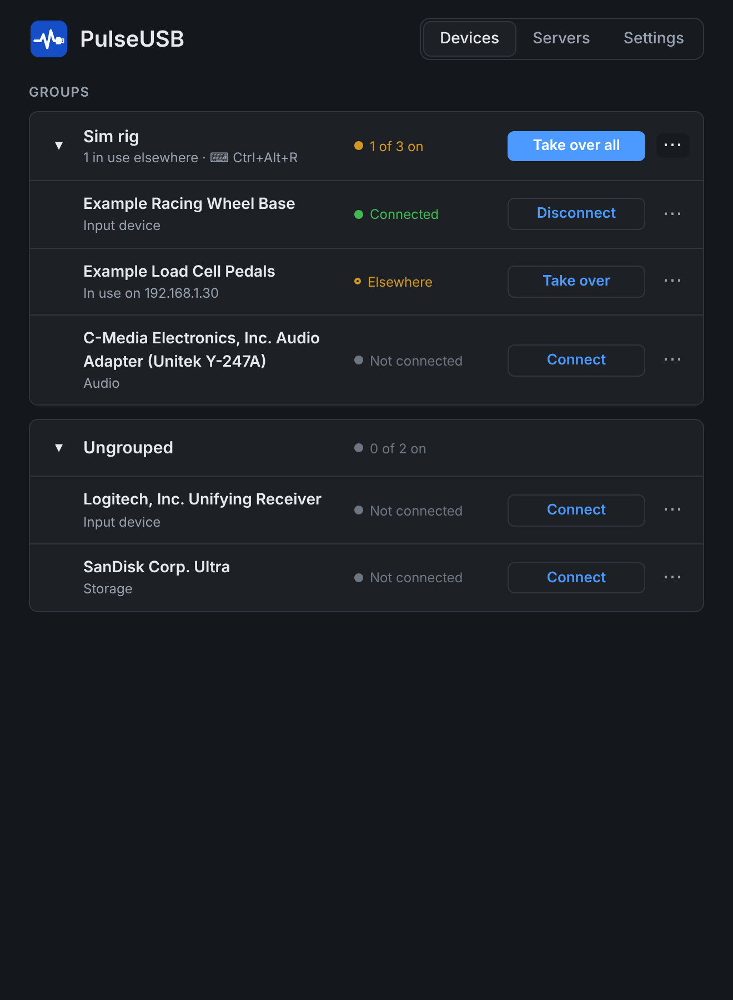

# PulseUSB

Use USB devices that are plugged into another computer, over your home
network, as if they were plugged in locally.

Built for a sim rig run from a gaming PC in another room: the wheel,
pedals, shifter, button boxes and bass-shaker sound card plug into a small
Linux box at the rig, and the gaming PC uses them as its own. It works for
any USB device: keyboards and mice, controllers, sound cards and
microphones, storage, and so on.

- **Lossless.** Every USB request travels unchanged, using the standard
  USB/IP protocol: no compression, no re-encoding, nothing dropped.
- **Two parts.** A server on the Linux machine the devices are plugged
  into, and an app (Windows or Linux) on the computer that uses them. The
  app finds servers on the network by itself.
- **Made for daily use.** Auto-connect at startup, your own names for
  devices, groups that connect together ("Sim rig"), a tray menu, keyboard
  shortcuts, and starting with Windows, even before you sign in.
- **Several computers.** A device in use elsewhere shows as such and can be
  taken over. If the keyboard and mouse you share are stuck on another
  computer, **Ctrl+Alt+Shift+F12** on that keyboard brings everything back,
  like the switch key of a KVM.

## Getting started

Downloads are on the [releases page](https://github.com/steppapig/PulseUSB/releases/latest).

### 1. The server: on the Linux machine the devices are plugged into

Any 64-bit Linux with systemd: a Raspberry Pi, a mini PC, an old laptop.
Download `pulseusb-server-linux-arm64` (Raspberry Pi and other ARM boards)
or `pulseusb-server-linux-amd64` (Intel/AMD), then:

    chmod +x pulseusb-server-linux-amd64
    sudo ./pulseusb-server-linux-amd64 install

The installer asks for a name for the server and which devices to share,
starts it as a service, opens the firewall port if a firewall is running,
and on a laptop offers to keep it running with the lid closed. Run it again
to change the setup; `sudo pulseusb-server uninstall` removes it.

### 2. The app: on the computer that uses the devices

**Windows 10 (1903 or later) or 11:** run `PulseUSB-Setup.exe`. It installs
the app for your account and the free [usbip-win2](https://github.com/vadimgrn/usbip-win2)
driver it relies on; Windows asks for administrator permission once, for
the driver.

**Linux:** download `pulseusb-linux-amd64` (or `-arm64`), then:

    chmod +x pulseusb-linux-amd64
    sudo ./pulseusb-linux-amd64 install

This sets PulseUSB up as a service (plugging a remote device in needs root
on Linux), installs what its window needs, and adds "PulseUSB" to the
application menu.

### 3. Connect

Open PulseUSB. It finds the server and lists its devices: press Connect.
To have a device connected every time, open its ⋯ and tick Auto-connect.

## Using the app

- **Devices** shows every device the servers share, with its own name.
  One button connects or disconnects; ⋯ holds your name for the device, its
  group, auto-connect, hiding it, and under Advanced its receive mode.
  Settings follow the device, not the USB port it is in.
- **Groups** connect and disconnect together: the group's button, the tray
  menu or a keyboard shortcut switches them all.
- **In use elsewhere**: a device one computer is using cannot be used by
  another at the same time. Take over moves it here.
- **Servers** lists the servers you use; add one by address if it is not
  found automatically (for example on another network segment).
- **Settings**: start with Windows (when you sign in, or at boot before
  sign-in), start minimized, minimize to the tray, keyboard shortcuts,
  theme, and recent connection timings for troubleshooting.

On Windows the app lives in the tray: left click opens the window, right
click lists groups and devices to connect or disconnect.

## Tips and troubleshooting

- **Server not found:** both computers must be on the same network, and port
  3240 (TCP and UDP) must be open on the server. The installer opens it in
  firewalld and ufw. You can always add the server by address.
- **A device connects but does nothing:** some Linux drivers switch a
  device into another mode before it is shared. Logitech wireless receivers
  are the known case; the server installer offers the fix (it switches off
  the `hid_logitech_dj` driver on the server).
- **A key seems stuck on Windows** (Win, Ctrl...): use "Release stuck keys"
  in the tray menu. PulseUSB normally prevents this when keyboards move
  between computers.
- **A game controller with audio (DualSense) becomes the default sound
  device:** choose your sound devices by name in Discord, SimHub and games,
  or disable the controller's audio in Windows' sound settings (some games
  use it for haptics).
- **Microphone whine or audio clicks:** sound devices use the "Bulk data"
  receive mode by default; try the other mode under ⋯ → Advanced. Use a
  wired network: audio is the most timing-sensitive kind of USB device.
- **Windows Defender or SmartScreen warns:** the program is not yet
  code-signed. The builds on the releases page are made from this source by
  GitHub's build service; check the file's SHA-256 against the release.
- **Laptop as server:** the installer can keep it running with the lid
  closed; if it still sleeps, check `journalctl -b | grep -i suspend`.

## Security

USB/IP has no passwords or encryption: anyone on the same network can see
and use the devices a server shares. Use it on a network you trust. To
restrict a server to particular computers, add `-allow` to its service
(`-allow 192.168.1.20` or `-allow 192.168.1.0/24`); a firewall or VPN works
too.

## Reference

### Server options

    pulseusb-server -list                       # show shareable devices
    pulseusb-server -all                        # share every device except hubs
    pulseusb-server -d 046d:c52b -d 1-1.4       # share devices by vendor:product or port
    pulseusb-server -name simrig                # the name the apps show
    pulseusb-server -allow 192.168.1.0/24       # only these computers
    pulseusb-server -escape Ctrl+Alt+Shift+F12  # the KVM-style keys ("off" disables)
    pulseusb-server -no-discovery               # do not answer network searches
    pulseusb-server -v                          # log every USB request (troubleshooting only)
    pulseusb-server release [device|all]        # use devices on the server machine again
    pulseusb-server share [device|all]          # let other computers have them again

The service's options are on the `ExecStart` line of
`/etc/systemd/system/pulseusb-server.service`. While a client uses a device,
the server keeps the processor out of deep sleep states so idle wake-up
delays do not reach your inputs.

### Command-line client

`pulseusb-client` does what the app does, for scripts: `discover`, `list`,
`attach`, `auto`, `ports`, `detach`. On Windows it needs the usbip-win2
driver; on Linux root and the `vhci-hcd` kernel module.

### Where settings are kept

| | Settings file |
|---|---|
| Windows app | `%AppData%\PulseUSB\config.json` |
| Linux app (installed as a service) | `/etc/pulseusb/config.json` |
| Linux app (run directly) | `~/.config/PulseUSB/config.json` |
| Server | none; its options are on its service's command line |

## How it works

The server takes a device away from its own Linux drivers through usbfs and
forwards its USB traffic over TCP in the USB/IP format. On Windows, the
[usbip-win2](https://github.com/vadimgrn/usbip-win2) driver presents the
device to Windows as if it were plugged in; on Linux, the kernel's own
`vhci-hcd` driver does. A few PulseUSB extensions to the protocol (device
names and kinds, who is using what, taking devices over) are ignored by
other USB/IP software, so the server also works with the standard `usbip`
tools.

## Building from source

Go 1.23 or later; no other dependencies. Everything is built without cgo.

    CGO_ENABLED=0 go build -o bin/ ./cmd/pulseusb-server ./cmd/pulseusb-client
    GOOS=windows GOARCH=amd64 CGO_ENABLED=0 go build -ldflags="-H=windowsgui" -o bin/PulseUSB.exe ./cmd/pulseusb-gui
    GOOS=linux GOARCH=arm64 CGO_ENABLED=0 go build -o bin/ ./cmd/pulseusb-server

The Windows setup program is built with NSIS from `installer/pulseusb.nsi`
(the GitHub workflow does this, and bundles the usbip-win2 installer when
it can). The icon and Windows version details come from
`cmd/pulseusb-gui/app.rc`; the logo is drawn by `tools/logo.py`.

Run the window against a simulated rig, without any hardware:

    PULSEUSB_DEMO=1 go run ./cmd/pulseusb-gui

Tests: `go test -race ./...`

## Licence and credits

PulseUSB is released under the [MIT licence](LICENSE).
It builds on [usbip-win2](https://github.com/vadimgrn/usbip-win2), the
[usb.ids](http://www.linux-usb.org/usb-ids.html) database and the Go
libraries listed in [THIRD_PARTY.md](THIRD_PARTY.md); their licences are in
`internal/licenses/THIRD_PARTY_LICENSES.txt` and inside every program.
